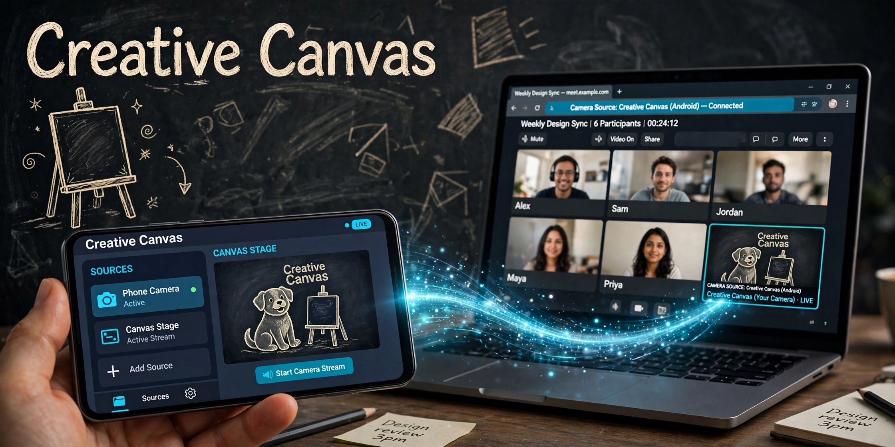

# Creative Canvas for Android

**A tiny TV studio for Discord.** Put your **camera**, a **website**, a **video** and **chat words** on one stage. Creative Canvas sends the whole stage to Discord as **one camera**.

Your phone is the control room. Any site that needs a camera source, Discord, Zoom, a video call in your browser, just sees Creative Canvas as a normal camera.

📖 **Full illustrated guide:** https://jordanalbiar.github.io/creative-canvas-apk

## What it is

- **Left is the Dashboard, the remote control.** Right is the **Canvas, the stage**. They are docked together and always move as one.
- Everything is a box on the stage, you, a website, a video, chat words. Drag a box to move it. Pull its corner to make it bigger.
- The app hands the whole stage to Discord as **one pretend camera**. Your friends just see a normal camera in the call. Showtime.

## The whole app in one picture. What the numbers mean

**1 · The remote control** (left, top). This is the **Dashboard**. It sticks to the left side of the stage. Move the stage, the remote comes too. Make the stage bigger or smaller, the remote shrinks or grows to fit.
*Say it like this: "The remote is stuck to the stage."*

**2 · Pick a job** (left, tab row). These 6 little buttons each do **one job**, words, video, pictures, numbers, settings, or colours. The **blue one** is open right now.
*Say it like this: "Tap a button, pick a job."*

**3 · Change the settings** (left, under the tabs). This is where you **change the thing you picked**. In the picture, it is changing a website. Give it a name, paste its link, and choose how Discord sees it.
*Say it like this: "Pick a thing, then change it here."*

**4 · Add a website** (right, top bar). Paste a link in the box. Press **Load**. The website appears on the stage. You can also pick the dark **Night** look and the picture size, **720p**, big and clear.
*Say it like this: "Paste a link. Press Load."*

**5 · The stage** (right, the big black box). This is **what your friends will see**. Everything is a box on the stage, you, a website, a video, chat words. Drag a box to move it. Pull its corner to make it bigger.
*Say it like this: "What's on the stage is the show."*

**6 · Add more things** (right, bottom row). Tap the big **+** to add something new. The tiny **MEM** word tells you how much memory the app is using.
*Say it like this: "Tap plus to add more."*

## The 6 tabs

| Tab | What it does |
| --- | --- |
| ✎ **Text** | Write **words on top** of the picture, like a title on a book cover. |
| 🎬 **Video** | Play a **video**, a link, a YouTube video, or one saved on your phone. |
| 🖼 **Image** | Put a **photo or logo** on the stage. Slide it around. Big or small. |
| 📊 **Stats** | See **simple numbers** about the app, like how much memory it is using. |
| ⚙ **Settings** | Change the thing you picked. |
| 🎨 **Appearance** | Change how it **looks**, like the dark Night colours. |

Two more things live on the stage, too: **chat words**, your friends' messages drawn on top, in big letters, and **your camera**, front or back, in a box just like everything else.

## How the webviewer works. How any website loads

The **Webviewer** is a tiny web browser that lives **inside** Creative Canvas. Give it a link, **any link**, and it opens that website in its own little window, right on the stage.

1. **Paste a link**. Type or paste the website's address in the **Website URL** box at the top of the Canvas, or in the Web Source settings in the Dashboard. A YouTube link, a vdo.ninja link, a news page, **any website works the same way**.
2. **Press Load or Apply**. Press **Load** up top, or **Apply** in the settings. That tells the Webviewer: *"Go get this page."* It fetches the website, just like a normal browser does when you open a tab.
3. **The site opens inside the app**. The website loads in a **small window inside the Canvas**, that window is called an **iframe**. The site is really there, live: videos can play, pages can scroll, and with **Interactive** switched on, your taps work on the site itself.
4. **It becomes a box on the stage**. Once loaded, the website is just **one box on the stage**, like your camera or a picture. Drag it to move it, pull its corner to resize it, and use **Zoom in / Zoom out** in its settings to make the page inside look bigger or smaller so it fits just right.
5. **Mirror sends it to Discord**. Tick **Mirror** and the app takes **fast photos of the Webviewer, 10 times every second**, and puts them on the broadcast. That is how the website, YouTube included, reaches your friends in Discord as moving video, even when a site will not share itself directly.
6. **Stuck? Reload it**. If a page gets stuck or stays black, press **Reload source** to load it again, or **Open in a new tab** to see it full-size. Some sites say "no" to living inside another page, for those, the **Mirror** trick in Step 5 is the way around.

In short: **link in → Webviewer loads it → it sits on the stage → Discord sees it.** One Webviewer per Web Source. Add more sources to show more websites at once.

## How it works. Just 4 steps

1. **Pick a thing**. Camera, website, YouTube, video, picture, words, or chat.
2. **Put it on the stage**. Move it. Size it. Stack it. The stage is the finished picture.
3. **Send it as one camera**. The app hands the whole stage to Discord as **one pretend camera**.
4. **Friends watch**. Your friends just see a normal camera in the call. Showtime.

## Good to know

- **Docked, in the middle**. The remote and the stage **open together, right in the centre**. They always move as one, and the app remembers where you left them.
- **It shrinks for tiny screens**. Splitting your screen with a friend? The whole thing **gets smaller to fit**. Nothing falls off the edge.
- **Tiny window? No freezing**. Shrink the app into a little floating window and the website **keeps playing**. No freeze, no refresh needed.
- **It remembers your work**. Where things sit, how big they are, the zoom, the dock, **all saved**. For a video file, it saves only the file's **name**, not the video itself.

## Download

**Creative Canvas v3.2 · Android APK · 1.1 MB**

📥 **[Download creative-canvas-v3.2.apk](creative-canvas-v3.2.apk)**

On the [landing page](https://jordanalbiar.github.io/creative-canvas-apk) the download button only appears after you accept the Terms of Use. The short version:

1. **What you're getting**. Creative Canvas v3.2 is an Android app (an APK file) that puts your camera, websites, videos and chat on one stage and sends it to Discord as one virtual camera.
2. **It's free, and it's "as is"**. Provided as it is, with no promise it will work perfectly on every phone.
3. **Install it yourself**. You're downloading the file directly, not from an app store. Only install it if you trust this page. Your phone may ask you to allow installs from your browser, that's normal for an APK, and you can turn that permission back off afterwards.
4. **Only show what's yours**. Share cameras, websites, videos and words that are yours, or that you have permission to show.
5. **Follow the house rules where you share**. When you use Creative Canvas with Discord or any other service, that service's own rules still apply to you.
6. **Be kind on camera**. Don't use the app to bother, trick or harm other people, and don't record or share anyone without their okay.
7. **Your phone, your choice**. Nothing is installed until you open the APK yourself. You can delete the file, or uninstall the app, at any time.

When the download finishes, open it on your Android phone to install.

## Version

**v3.2 is the one in use · v3.3 adds the dock, zoom & the touch switch.**
